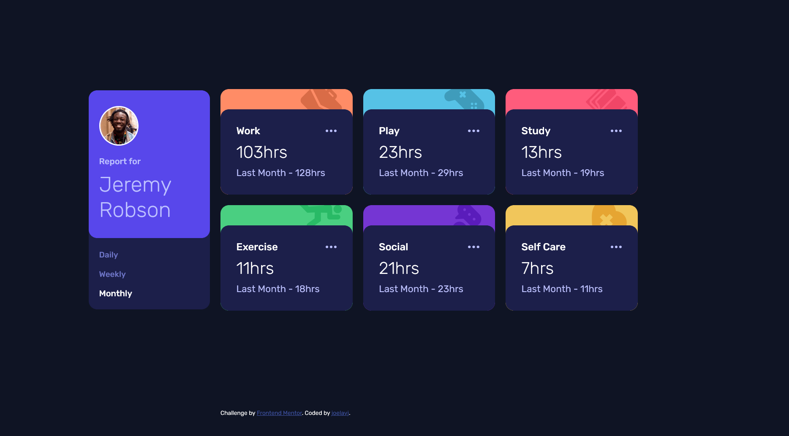

# Frontend Mentor - Solution du Time tracking dashboard

Voici ma solution au [défi Time tracking dashboard de Frontend Mentor](https://www.frontendmentor.io/challenges/time-tracking-dashboard-UIQ7167Jw). Les défis Frontend Mentor permettent de progresser en construisant des projets réalistes.

## Sommaire

- [Aperçu](#aperçu)
  - [Le défi](#le-défi)
  - [Capture d'écran](#capture-décran)
  - [Liens](#liens)
- [Mon processus](#mon-processus)
  - [Technologies utilisées](#technologies-utilisées)
  - [Lancer le projet](#lancer-le-projet)
  - [Ce que j'ai appris](#ce-que-jai-appris)
  - [Pistes d'amélioration](#pistes-damélioration)
  - [Collaboration avec l'IA](#collaboration-avec-lia)
- [Auteur](#auteur)

## Aperçu

### Le défi

L'utilisateur doit pouvoir :

- Voir une mise en page adaptée à la taille de son écran
- Voir les états de survol des éléments interactifs
- Basculer entre les statistiques **Daily**, **Weekly** et **Monthly**

Le texte de la période précédente change selon la période active : « Yesterday » pour Daily, « Last Week » pour Weekly et « Last Month » pour Monthly (par exemple « Last Week - 36hrs »).

### Capture d'écran



### Liens

- Code source : [github.com/joelavj](https://github.com/joelavj)
- Profil Frontend Mentor : [@joelavj](https://www.frontendmentor.io/profile/joelavj)

## Mon processus

### Technologies utilisées

- HTML5
- CSS3 : Flexbox, CSS Grid, media queries (approche mobile-first avec `min-width`)
- JavaScript natif (sans framework) : API `fetch`, `async/await`, template literals, manipulation du DOM
- Données locales dans un fichier `data.json`
- Police [Rubik](https://fonts.google.com/specimen/Rubik) (fichier variable, poids 300 à 500)

### Lancer le projet

Les données sont chargées avec `fetch`, qui ne fonctionne pas en ouvrant `index.html` directement (`file://`). Il faut passer par un serveur local, par exemple :

- l'extension **Live Server** de VS Code, ou
- `python -m http.server`, puis ouvrir `http://localhost:8000`.

### Ce que j'ai appris

La partie la plus importante de ce projet pour moi a été de **charger et afficher des données JSON avec `fetch`**.

Le dashboard n'a pas les chiffres écrits en dur dans le HTML : tout vient de `data.json`. Chaque activité y contient ses heures pour les trois périodes :

```json
{
  "title": "Work",
  "timeframes": {
    "daily":   { "current": 5,  "previous": 7 },
    "weekly":  { "current": 32, "previous": 36 },
    "monthly": { "current": 103, "previous": 128 }
  }
}
```

La fonction `getData` est appelée au clic sur un bouton du menu (et une fois au chargement avec `'weekly'`). Elle suit quatre étapes :

```js
async function getData(idNav) {
    try {
        // 1. On attend la réponse de la requête HTTP
        const res = await fetch('./data.json');

        // 2. On vérifie que la requête a réussi
        if (!res.ok) {
            return false;
        }

        // 3. On attend la conversion de la réponse en JSON
        const data = await res.json();

        // 4. On vide les cartes, on active le bouton, puis on génère l'affichage
        cardsContainers.innerHTML = "";
        activeBtn(idNav);
        switch (idNav) {
            case 'daily':   generateCardDaily(data);   break;
            case 'weekly':  generateCardWeekly(data);  break;
            case 'monthly': generateCardMonthly(data); break;
        }
    } catch (error) {
        // Erreur réseau, JSON invalide, etc.
        return false;
    }
}
```

Ce que j'en retiens :

- `fetch` renvoie une **promesse** : `await` permet d'attendre la réponse sans bloquer la page.
- Il faut **vérifier `res.ok`** avant de lire le corps de la réponse, car `fetch` ne lève pas d'erreur pour un statut 404 ou 500.
- `res.json()` est lui aussi asynchrone, d'où un deuxième `await`.
- Le `try/catch` attrape les erreurs réseau et les JSON invalides.

Ensuite, chaque fonction `generateCard…` parcourt le tableau avec `forEach` et construit une carte avec un template literal. Un détail que j'aime bien : l'identifiant de la carte est dérivé du titre, ce qui sert à la fois pour l'icône et pour la couleur CSS.

```js
const id = title.toLowerCase().replace(/ /g, "-");   // "Self Care" -> "self-care"
//  et <div id="${id}"> (couleur définie en CSS avec #self-care)
```

J'ai aussi travaillé la mise en page responsive : une seule colonne sur mobile, des cartes en `flex-wrap` sur tablette, puis une grille `grid-template-columns` avec le profil à gauche sur desktop.

### Pistes d'amélioration

Un diagnostic du projet m'a permis de repérer ce qu'il reste à améliorer. Pour le `fetch` et le JavaScript :

- Charger `data.json` **une seule fois** au démarrage et garder les données en mémoire, au lieu de refaire une requête à chaque clic.
- Fusionner `generateCardDaily`, `generateCardWeekly` et `generateCardMonthly` en une seule fonction `render(data, timeframe)`, avec une table de correspondance pour les libellés (`Yesterday`, `Last Week`, `Last Month`).
- Construire le HTML dans une chaîne, puis assigner `innerHTML` une seule fois, au lieu de `innerHTML +=` dans la boucle.
- Afficher un message à l'utilisateur quand le chargement échoue, plutôt que de renvoyer `false` silencieusement.
- Remplacer les `onclick` inline par des `addEventListener`, et cibler `nav button` plutôt que tous les `button`.

Côté CSS et accessibilité :

- Corriger le débordement horizontal entre 1000 px et environ 1150 px de large (colonnes à largeur fixe).
- Ajouter le survol des boutons du menu, et aligner la couleur de survol des cartes et celles des textes secondaires sur la maquette.
- Ajouter des attributs `alt` sur les images, transformer le bouton « … » en vrai `<button>`, et améliorer certains contrastes.
- Corriger le chemin du favicon (`./assets/images/favicon-32x32.png`).

### Collaboration avec l'IA

J'ai utilisé Claude pour obtenir un diagnostic du projet : comparaison avec les maquettes, test du rendu à plusieurs largeurs, vérification des contrastes et revue du code JavaScript. Les pistes d'amélioration ci-dessus en sont issues.

## Auteur

- GitHub : [@joelavj](https://github.com/joelavj)
- Frontend Mentor : [@joelavj](https://www.frontendmentor.io/profile/joelavj)